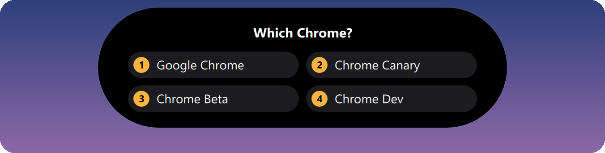
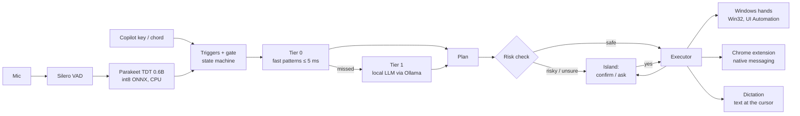

<div align="center">

# Nova

**Talk to your Windows laptop. It does it at hand speed — entirely on your machine.**

A Dynamic-Island pill at the top of the screen that listens, understands loose phrasing, and acts:
apps, windows, tabs, web pages, Canvas, dictation. No cloud, no API keys, $0.


[](https://github.com/Bhavya007-17/Project-Nova/actions/workflows/tests.yml)


</div>

---

## Why Nova

Voice assistants are either cloud services that are slow and send everything you say off your machine, or rigid
command lists you have to memorize. Nova is neither:

- **Hand-speed.** The target is how long you'd take by hand: obvious commands start in ~0.3 s.
- **Loose phrasing.** "Fusion on the left, Claude on the right" works without a phrase list. A small local LLM handles
  what the fast path misses.
- **Asks instead of guessing.** Unsure? It shows a question with numbered choices in the island. Risky? It confirms first.
- **Local and free.** Speech-to-text, understanding, dictation cleanup and every action run on your laptop.
- **Light.** Idle Nova is a mic plus a voice-activity detector (~2 % of one core). The LLM loads on demand and unloads
  when idle, so it stays out of the way of GPU-heavy apps like Autodesk Fusion.

## Features

### Listens the way you want
Hold the Copilot key to talk, tap it to talk until you stop, say "Nova, …", or leave always-listening on for plain
commands. Live words show while you speak.


### Does things, step by step
Opens, switches, closes and arranges apps; snaps and maximizes windows; manages tabs; types; presses keys; controls
volume and media; runs web searches. Each step shows in the island as it runs.


### Exact clicks on web pages, and Canvas
A Chrome extension maps the page's real elements (no screenshots, no vision model): "press the submit button",
"type physics into the search box", "scroll to the comments". Canvas is read from your own logged-in tab:
"what's due today", "open my assignment for today".

### Asks when it isn't sure


### Confirms anything risky
Send, submit, delete, buy and post always wait for a yes: say it, click it, or press Enter (Esc = no).


### Dictation
Double-tap the Copilot key (or say "type this …") and clean text lands at the cursor sentence by sentence: fillers
removed, "scratch that" and "new paragraph" understood, self-corrections applied, spacing and capitals fitted to the
text already there. Works in Notepad, Word, Electron apps, Chrome and Google Docs ("open a Google Doc and type this").


### Plain-language errors


### Coming next (UI ready, shown with demo data)
| Learned skills ⚡ and "Show me?" teaching (Stage 08) | Handoff to Claude / ChatGPT with job chips (Stage 09) |
|---|---|
| <br> | <br> |

## How it works



- **Speech:** Silero VAD finds speech; NVIDIA's Parakeet TDT 0.6B v3 (int8, onnx-asr) transcribes it on the CPU.
- **Understanding:** Tier 0 handles obvious commands with patterns and the Start-menu app catalog (sound-alike names
  like "Claire" → Claude are offered as a question, never acted on blindly). Anything else goes to Tier 1: qwen3.5:4b
  on the GPU, or qwen3.5:2b on the CPU when VRAM is tight, with schema-forced JSON plans that are validated before
  anything runs.
- **Hands:** Win32 + UI Automation for apps, windows, keys and text; a Manifest V3 Chrome extension over native
  messaging (a named pipe, no TCP port) for web pages.
- **Island:** PySide6 / Qt Quick, click-through, never steals focus, hidden from screenshots and screen shares.

Full design: [`docs/SPEC.md`](docs/SPEC.md).

## Quick start

**Needs:** Windows 11 · [Git](https://git-scm.com/) · [uv](https://docs.astral.sh/uv/) ·
[Ollama](https://ollama.com/download/windows) · Chrome · ~6 GB of disk for models. An NVIDIA GPU makes the LLM path
faster but isn't required.

```powershell
git clone https://github.com/Bhavya007-17/Project-Nova.git
cd Project-Nova
powershell -ExecutionPolicy Bypass -File scripts\setup.ps1   # deps, models, LLMs, Chrome bridge, doctor
```

Then load the Chrome extension once: `chrome://extensions` → **Developer mode** → **Load unpacked** → the repo's
`extension` folder. Start Nova:

```powershell
uv run nova            # tray app; the island appears when you talk
```

No Copilot key? Use the chord **Ctrl + Alt + N** (hold to talk, tap to talk until you stop), or just say "Nova, …".

### Try it
| Say | Nova |
|---|---|
| "Open Spotify" / "close Chrome" / "switch to Claude" | opens, closes, switches apps |
| "Fusion on the left, Claude on the right" | arranges windows side by side |
| "New tab" / "go to the YouTube tab" / "go back" | tabs and navigation |
| "What's due today?" | reads your Canvas and answers in the island |
| "Press the blue button" / "scroll to the comments" | exact clicks on the current page |
| "Pause the music" / "volume 30" | media and volume |
| "Open a Google Doc and type this: …" | a new doc, your words land cleaned up |
| *double-tap Copilot* | dictation into whatever has the cursor |

No mic handy? `uv run nova say "fusion on the left, claude on the right"` runs the whole brain on typed text
(`--dry` shows the plan without doing it).

## Commands

| Command | What it does |
|---|---|
| `uv run nova` | tray app (the default) |
| `uv run nova doctor` | checks the laptop: mic, GPU, Ollama, models, Chrome, keyboard hook… |
| `uv run nova listen` | live transcription with timings (`--wav file` replays audio, `--gate` shows trigger verdicts) |
| `uv run nova island --demo [scene]` | every island state with fake data |
| `uv run nova say "<text>"` | run a command from text (`--dry`: plan only) |
| `uv run nova eval` | intent accuracy, false actions and Tier 1 latency on `docs/eval/intents.yaml` |
| `uv run nova latency` | p50 / p95 per command type from your own logs |
| `uv run nova bench-stt` / `bench-llm` | speech-to-text WER; candidate local LLMs × GPU / CPU / Arc |
| `uv run nova keys --probe` | what the Copilot key sends |
| `uv run nova chrome --install` | registers the extension's native-messaging host |
| `uv run pytest` | unit tests (1,360+) |

## Configuration

Everything is in `config/`, reloaded within a second of saving:

- `settings.yaml` — wake name, triggers, fallback chord, mic, LLM models and device, keep-alive, whether logs keep
  transcripts, dictation cleanup.
- `aliases.yaml` — short names for apps and sites ("canvas" → your Canvas URL, "fusion" → Autodesk Fusion).
- `vocab.yaml` — names speech-to-text should spell right.

Local data stays local: `logs/traces.jsonl` (timings and commands per utterance), `data/` (app catalog, dictation
history), `models/`. All git-ignored.

## Numbers

Measured on the reference laptop (Core Ultra 9 285H, RTX 5070 Laptop 8 GB) from real use, in ms from the end of
speech (`uv run nova latency`):

| Path | First action p50 | p95 | Done p50 |
|---|---|---|---|
| Tier 0 commands (no AI), 108 commands | 276 | 536 | 436 |
| Tier 1 local LLM on GPU, 35 commands | 1670 | 6958 | 1806 |
| Click on a web page, 18 commands | 300 | 1454 | 841 |
| Dictation segment lands, 21 segments | 79 | 359 | 720 |

Intent eval (`nova eval`): **95.8 %** plans correct (251 / 262); **0 false actions** behind the follow-up gate.
Island: key press → first frame 10–19 ms. Idle: ~2 % of one core.

## Roadmap

| Stage | Feature | Status |
|---|---|---|
| 00 | Tray app, `nova doctor` | ✅ |
| 01 | Ears: mic → VAD → Parakeet → text (~0.4 s) | ✅ |
| 02 | Triggers: Copilot key, "Nova …", always-listening, follow-up window | ✅ |
| 03 | The island | ✅ |
| 04 | Windows hands + Tier 0 | ✅ |
| 05 | Local brain (Tier 1 LLM, asks when unsure) | ✅ |
| 06 | Chrome extension + Canvas | ✅ |
| 07 | Dictation | ✅ — *except the AI misheard-word fix* |
| 07a | Fast + hearing: reacts every time, loose requests in about a second | ⏳ |
| 07b | Talk sessions: open the mic once, talk naturally, each clause acts | ⏳ |
| 07c | Control anything: scroll PDFs, click by name or number, camera, screenshot | ⏳ |
| 08 | Teach + learn: "Show me?", auto-learned shortcuts ⚡ | ⏳ |
| 09 | Handoff to the Claude / ChatGPT apps, voice mode, done notifications | ⏳ |
| 10 | Safety + polish: central risk audit, settings panel, start with Windows, crash watchdog | ⏳ |
| 11 | Speed + soak: every latency budget met, stable all day | ⏳ |
| 12 | Optional: Todoist / Notion / Calendar hooks, Nova as an MCP server | ⏳ |

**Not implemented yet, in detail:**
- **AI text fix (dictation).** The local model should fix misheard words ("meat" → "meet") after a sentence lands.
  The code, schema and divergence guard exist (`nova/dictation/cleanup.py`, unit-tested), but it doesn't work live
  yet: 0 of 1 live attempts landed.
- **Teach + learn** (Stage 08). Anything the LLM does successfully becomes an instant shortcut; anything Nova can't do,
  you show it once (it records Chrome and native steps with your narration) and it replays next time.
- **Handoff** (Stage 09). "Put my homework for today on Claude", "ask ChatGPT …", "on Claude, turn on voice" — through
  the desktop apps, with a toast when the answer is ready.
- **Safety + polish** (Stage 10). Settings panel, start with Windows, single instance, crash watchdog, battery/AC
  aware model choice.
- **Speed + soak** (Stage 11). Tier 1 is dominated by Ollama's ~0.8 s per-request overhead; a 2-hour always-listening
  soak with zero risky false actions.
- **Portability.** Built and measured on one laptop. Needs testing on machines without a Copilot key, without an
  NVIDIA GPU, at other display scales and with multiple monitors. Chrome is the only browser with page actions today.

## Built with AI agents

Nova is built stage by stage with Claude Code: each stage is a prompt in [`docs/prompts/`](docs/prompts/), done in its
own session, demoed live, then committed. The agent guide is [`AGENTS.md`](AGENTS.md) (Claude Code reads it via
[`CLAUDE.md`](CLAUDE.md)); measured facts that saved days are in [`docs/GOTCHAS.md`](docs/GOTCHAS.md).

## Project layout

```
nova/            the app: speech, triggers, island, brain (tier 0 / tier 1), actions, chrome, dictation
extension/       Chrome extension (MV3) + native-messaging host + self-test
config/          settings.yaml, aliases.yaml, vocab.yaml
docs/            SPEC.md, stage prompts, DEPS.md, GOTCHAS.md, intent eval, images
scripts/         setup.ps1, get_models.py, island_screenshots.py
tests/           unit tests for the pure logic
fixtures/        phrasing fixtures (voice recordings stay private and local)
```

## Contributing

See [`CONTRIBUTING.md`](CONTRIBUTING.md): setup, picking a stage, branches and pull requests (`main` is protected,
one approval + green CI).

## Team

- **Bhavya Dosi** — [@Bhavya007-17](https://github.com/Bhavya007-17) (owner)
- **Nischay Rawat** — [@nischayrawat17](https://github.com/nischayrawat17)
- **Shaashwat Mishra** — [@shaashwatmishra203-creator](https://github.com/shaashwatmishra203-creator)

## Acknowledgements

[Parakeet TDT 0.6B v3](https://huggingface.co/nvidia/parakeet-tdt-0.6b-v3) by NVIDIA (CC-BY-4.0), as ONNX via
[onnx-asr](https://github.com/istupakov/onnx-asr) ·
[Silero VAD](https://github.com/snakers4/silero-vad) (MIT) · [Ollama](https://ollama.com) ·
[Qwen 3.5](https://huggingface.co/Qwen) · [PySide6 / Qt](https://doc.qt.io/qtforpython-6/) ·
[ONNX Runtime](https://onnxruntime.ai).

No license has been chosen yet, so all rights are reserved by the authors.
